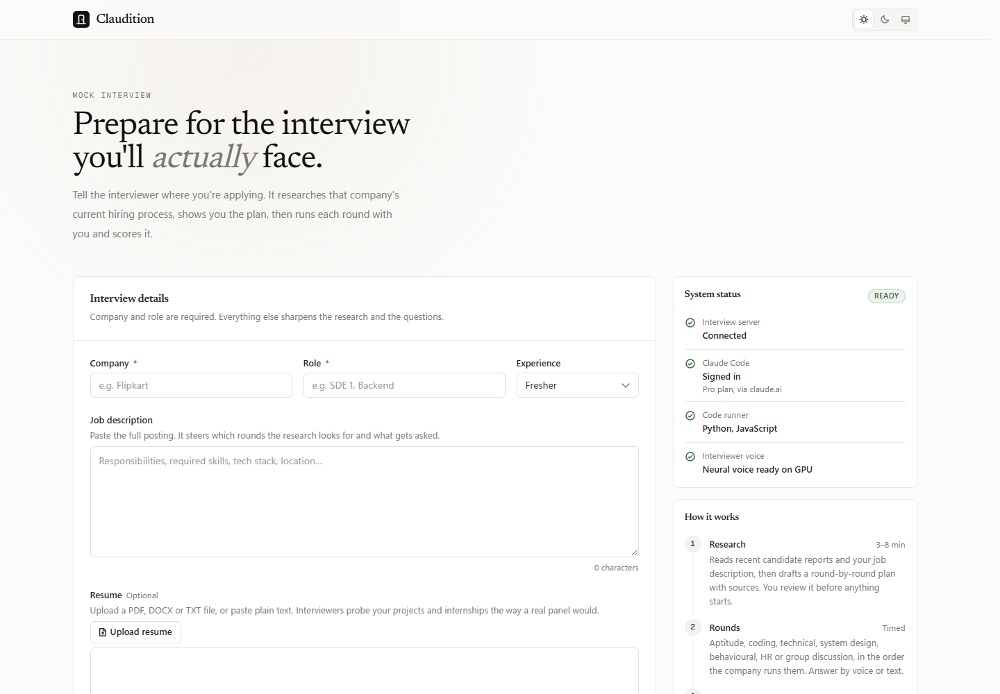
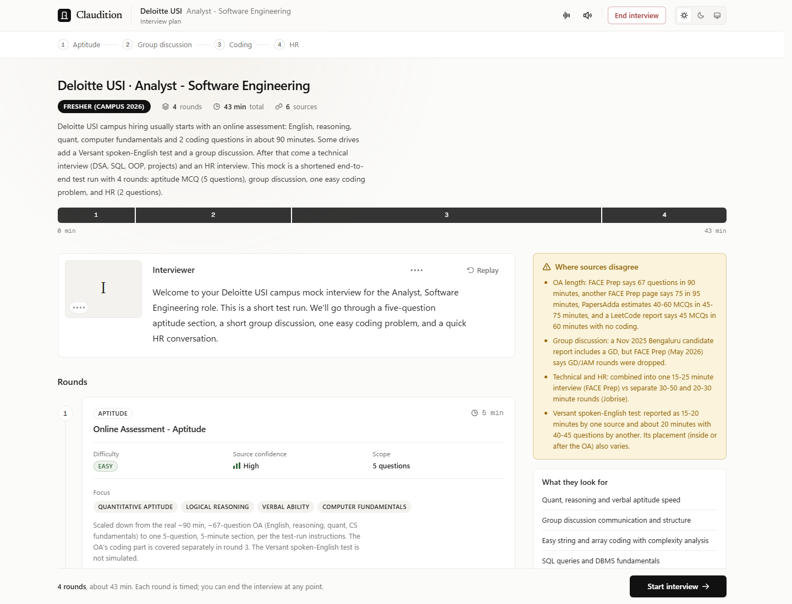
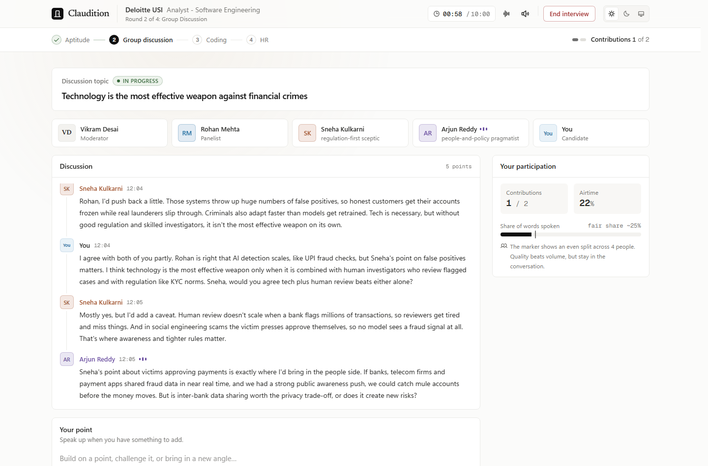
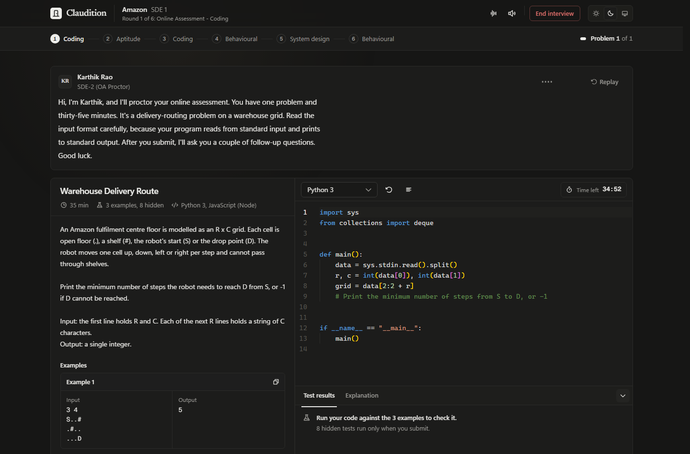
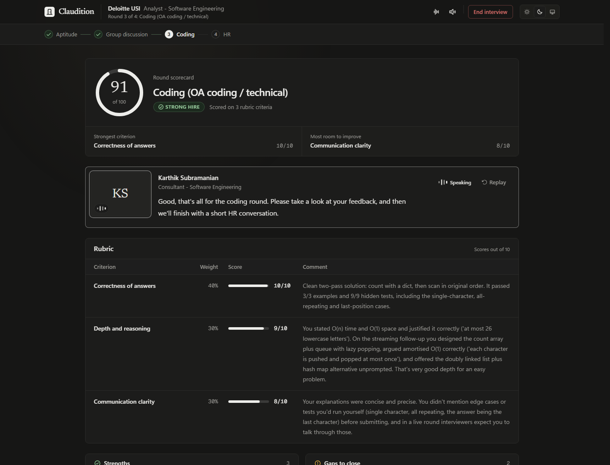
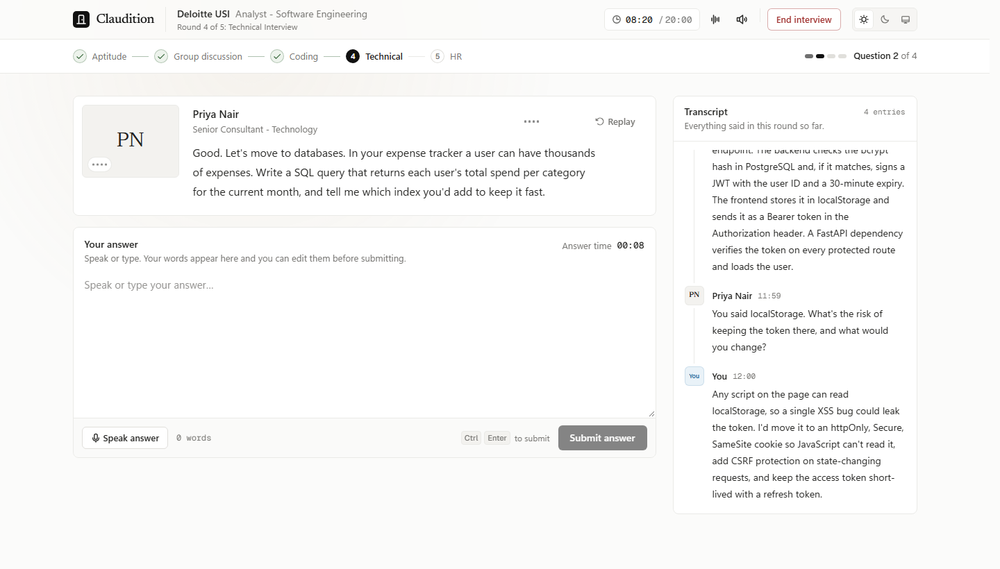
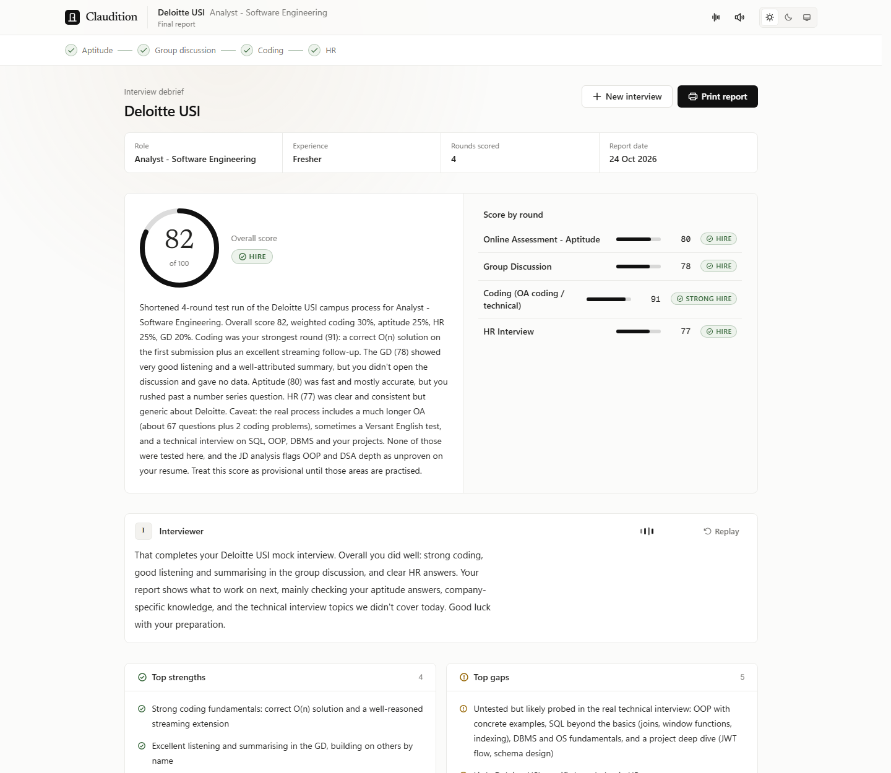
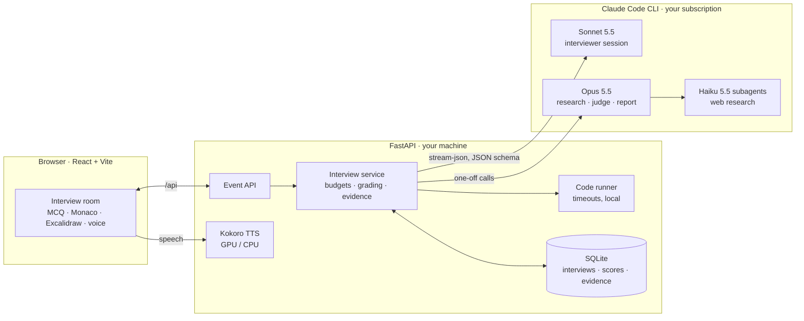
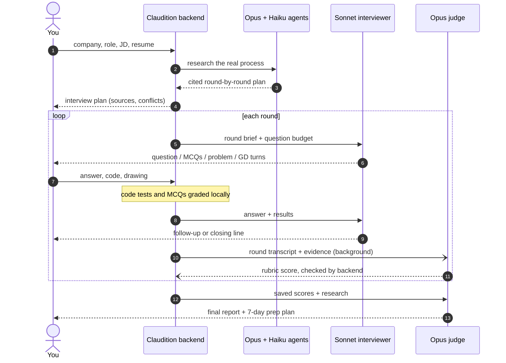
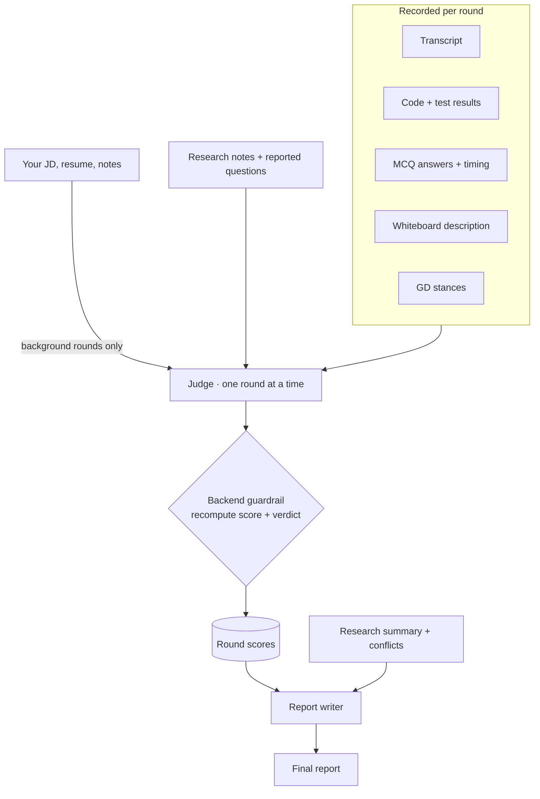

<div align="center">

# Claudition

**Prepare for the interview you'll *actually* face.**

AI mock interviews built from a company's real, researched hiring process, running locally on your own Claude Code subscription.

[Quick start](#quick-start) · [How it works](#how-it-works) · [Screenshots](#screenshots) · [Guardrails](#guardrails) · [License](#license)



</div>

You enter a company, a role, your experience, the job description and your resume. Claudition sends research agents to find how that company actually interviews, builds a cited round-by-round plan, and runs the whole drive in your browser:

- **timed aptitude MCQs**, graded by the backend;
- a **coding round** with hidden tests run on your machine;
- **voice interviews** (technical, HR, behavioural);
- **system design on a whiteboard**;
- a **group discussion** with AI participants.

A separate judge scores every round against a rubric, and you finish with a report and a 7-day prep plan.

> Source-available under the [PolyForm Noncommercial 1.0.0](LICENSE) license: free for personal, educational and non-profit use.

## Features

| | |
|---|---|
| **Researched, cited plan** | Parallel Haiku agents search the web for the company's real rounds and reported questions. The plan shows sources, a confidence level per round, and where sources disagree. Cached for 90 days. |
| **7 round types** | Aptitude MCQ, coding, technical, system design, behavioural, HR and group discussion, in the company's real order, each with a question budget the server enforces. |
| **Real coding round** | Monaco editor, with your code run locally against examples and hidden tests (Python and JavaScript, plus Java and C++ if installed). Hidden tests and MCQ answers never reach the browser. |
| **Whiteboard system design** | An [Excalidraw](https://github.com/excalidraw/excalidraw) canvas. Your boxes, arrows and notes become text the interviewer probes ("what happens if this Redis lock is lost?"). |
| **Voice** | Answer by speaking (Chrome/Edge) or typing. The interviewer speaks with Edge Natural voices, or the open-source Kokoro neural voice on your GPU. |
| **Honest, independent judging** | Each round is scored by a separate judge that sees only that round's evidence: transcript, code, MCQ answers, whiteboard, and your JD and resume for background rounds. The backend recomputes every score from the rubric. |
| **Resume upload** | PDF, DOCX or TXT. The text is extracted locally and stays editable. |
| **Minimal UI** | Light, dark and system themes, an editorial type scale, quiet motion. |

## Screenshots

| Interview plan with sources | Group discussion with AI panelists |
|---|---|
|  |  |
| **Coding round (dark)** | **Round scorecard (dark)** |
|  |  |
| **Technical interview** | **Final report** |
|  |  |

## How it works

### Architecture



The backend drives the official `claude` CLI in headless mode, so everything runs on **your own** Claude Code login. Every model reply must match a JSON schema (`--json-schema`), so the UI always receives a valid, typed step.

### One interview, end to end



### Who sees what



The interviewer and the judge are kept apart on purpose. The interviewer (Sonnet) runs the conversation in one long session. Each round is judged by a separate Opus call that reads only that round's evidence, so one strong round can't lift a weak one.

### Speed and token usage

Measured on the same short 4-round test interview while optimising the pipeline (API-equivalent cost; on a subscription it counts toward your usage limit instead):

| | Earlier version | Now |
|---|---|---|
| Total time | 191 s | **124 s** |
| Wait after a round's last answer | 14–18 s | **3–5 s** (scoring runs in the background) |
| Tokens processed | 391K | **~296K** |
| API-equivalent cost | ~$0.85 | **~$0.49** |

Techniques used:
- a lean system prompt instead of Claude Code's default;
- one persistent CLI process per interview;
- the interviewer stays on one model, so the prompt cache is never rebuilt;
- small single-round judge calls, using processes started in advance;
- whiteboards sent as text, not images.

## Quick start

You need these installed, plus a Claude **Pro or Max** subscription:

| Tool | Install |
|---|---|
| [Node.js 20+](https://nodejs.org) | installer from nodejs.org |
| [uv](https://docs.astral.sh/uv/) (installs Python for you) | Windows: `powershell -ExecutionPolicy ByPass -c "irm https://astral.sh/uv/install.ps1 \| iex"`<br>macOS/Linux: `curl -LsSf https://astral.sh/uv/install.sh \| sh` |
| [Claude Code](https://code.claude.com) | `npm install -g @anthropic-ai/claude-code` |

```bash
git clone https://github.com/nubbot77/Claudition.git
cd Claudition
```

| Windows | macOS / Linux |
|---|---|
| `start.cmd` (or double-click it) | `./start.sh` |

The start script checks the tools above and signs you in to Claude Code if needed (`claude auth login`). It then installs and builds everything and opens **http://127.0.0.1:8000**. Run it again next time; it skips what's already done.

**Optional extras:**

- **Neural voice:** `start.cmd -Voice` / `./start.sh --voice` downloads about 1.9 GB once. It runs on an NVIDIA GPU (capped at 1 GB of GPU memory) or on the CPU.
- **More coding languages:** Java and C++ appear automatically when `javac`/`java` and `g++` are on your PATH.
- **Other models:** set `CLAUDITION_JUDGE_MODEL` / `CLAUDITION_INTERVIEWER_MODEL`, for example `claude-sonnet-5-5` if your plan has no Opus.
- **Very long sessions:** they are compacted in place at 400K tokens of context (`CLAUDITION_COMPACT_TOKENS`). Scoring doesn't depend on the summary, because the judge reads from the database.

<details>
<summary>Manual setup (developers)</summary>

```bash
cd backend && uv sync                      # add --extra voice for Kokoro
uv run uvicorn app.main:app --port 8000
cd frontend && npm install && npm run dev  # hot-reload UI on http://localhost:5173
```

The design preview with every screen is at `http://localhost:5173/__preview`.
</details>

## Guardrails

| Area | What protects the interview |
|---|---|
| Your account | Runs the unmodified `claude` CLI on your login. Never handles your credentials, strips `ANTHROPIC_API_KEY` so nothing is billed to an API key, never uses `--bare`. |
| Isolation | Interview turns run with **no tools**. Research gets only web search, web fetch and subagents. No MCP servers or personal settings are loaded. |
| Scoring | The backend recomputes every round score and verdict from the rubric (criterion names, weights, 0–10 limits). The report verdict comes from the overall score. |
| Grading | MCQs are graded and code is run by the backend, so the model can't invent test results. Hidden tests and answers never reach the browser. |
| Structure | Question budgets, at most 2 follow-ups per question, a time limit at 115% of the round's length, and a forced wrap-up. A step that breaks a rule is re-asked once. |
| Prompt injection | Web pages, transcripts and evidence are labelled as data, not instructions. The report may only make claims about the real process that the research supports. |
| Reliability | Schema-validated replies with one retry, timeouts, clear usage-limit and sign-in messages, one event at a time, failed scores retried before the report. |
| Uploads | Resumes are capped at 5 MB, 10 pages and 20,000 characters, and only text is extracted. Whiteboards are capped at 400 elements. |

## Troubleshooting

| Problem | Fix |
|---|---|
| "Claude Code isn't signed in" | Run `claude auth login` with your Pro/Max account and reload. `claude auth status` should show `"authMethod": "claude.ai"`. |
| Usage-limit error mid-interview | Wait for your plan's 5-hour reset, then press Retry. The interview resumes where it stopped. |
| `start.ps1` cannot be loaded | Use `start.cmd`, which runs it with a one-time execution-policy bypass. |
| Port 8000 in use | `.\start.ps1 -Port 8010` or `PORT=8010 ./start.sh` |
| Microphone doesn't work | Use Chrome or Edge and allow microphone access for `127.0.0.1`. |

## Usage and terms

Each interview turn counts toward **your** plan's usage limits. **Don't host Claudition for other people on your subscription**: Anthropic's terms don't allow routing other users through your plan. Everyone runs their own copy with their own Claude login.

## Tech stack

**Frontend:** React 18, TypeScript, Vite, Tailwind v4, shadcn/ui, Motion, Phosphor icons, Monaco, Excalidraw, Web Speech API.

**Backend:** Python, FastAPI, Pydantic, SQLite, pypdf, Kokoro TTS on ONNX Runtime (CUDA).

**AI:** Claude Code CLI in headless mode (Opus / Sonnet / Haiku), with JSON-schema output and subagents.

**Tests:** pytest, 89 tests, including an end-to-end interview flow with a fake model.

<details>
<summary>Project layout</summary>

```
start.cmd / start.ps1 / start.sh   one-command setup and launch
backend/app/
  main.py            FastAPI routes; serves the built UI
  interview.py       interview flow, background judging, evidence, guardrails
  claude_runner.py   claude CLI: persistent sessions, pre-started one-off calls, compaction
  routing.py         which model handles which turn
  budget.py          per-round question budgets
  rubrics.py         scoring rubrics and calibration per round type
  schemas.py         Pydantic models -> JSON schema for --json-schema
  code_runner.py     local code execution with timeouts
  diagram.py         Excalidraw board -> text for the interviewer and judge
  resume.py          PDF / DOCX / TXT resume text extraction
  tts.py             Kokoro neural TTS (GPU with CPU fallback)
  prompts/           interviewer, judge and report prompts; agents.json
frontend/src/        React + TypeScript UI
docs/screenshots/    images used in this README
```
</details>

## Disclaimer

Claudition is an independent project, not affiliated with or endorsed by Anthropic. Interview plans are built from public web sources and may be incomplete or out of date. Scores are practice feedback, not a hiring prediction.

## License

[PolyForm Noncommercial License 1.0.0](LICENSE): use, modify and share for personal, educational, research and non-profit purposes. Commercial use is not permitted.
